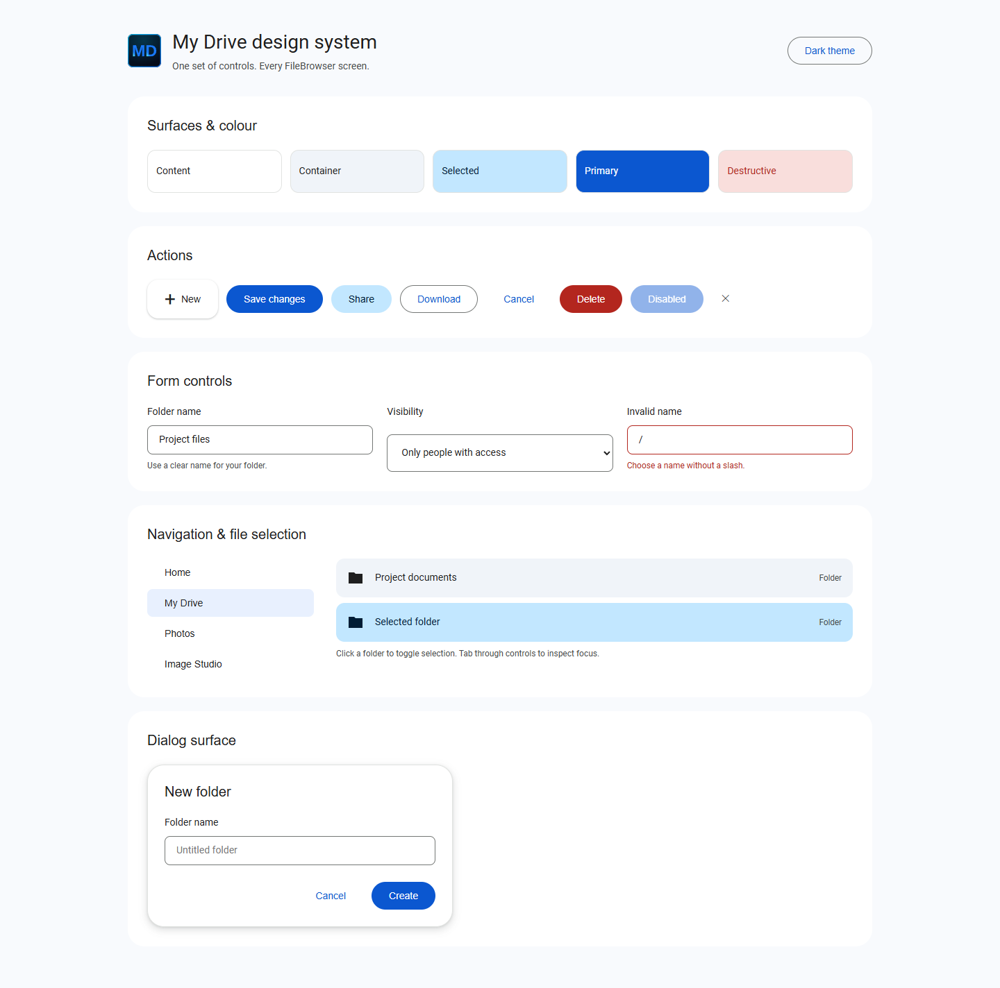
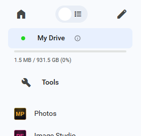

# Drive design system

Shared local styles for FileBrowser's navigation, file cards, buttons, menus,
dialogs and forms. The reference is Google Drive's current light interface;
dark mode uses matching semantic roles. FileBrowser keeps its own branding,
permissions, routes and behaviour.



[Dark controls](images/design-system/components-dark.png) ·
[Desktop FileBrowser](images/design-system/desktop.png) ·
[Mobile drawer and install banner](images/design-system/mobile-drawer.png)



## Sources and ownership

Measured the visible Google Drive New button (56px high, white surface, 16px
corners, subtle elevation) and selected view control (`#c2e7ff`) in the browser
on 2026-10-15, alongside the supplied reference screenshots. This is an original
local stylesheet adapted to FileBrowser's markup, not a dependency on Google's
minified application CSS, internal class names or authenticated endpoints.
No Google assets, fonts or scripts are downloaded at runtime.

Public references: [Material colour roles](https://m3.material.io/styles/color/the-color-system)
and [Material Web button tokens](https://github.com/material-components/material-web/blob/main/docs/components/button.md).

## Files

| File | Responsibility |
| --- | --- |
| `frontend/src/css/drive-tokens.css` | Semantic light/dark colours, spacing, radii, dimensions, elevation, motion; aliases for existing components |
| `frontend/src/css/drive-controls.css` | Reusable controls and adapters for existing `.button`, `.input`, menus, dialogs, sidebar and cards |
| `frontend/src/css/drive.css` | App layout: header, search, breadcrumbs, file list and navigation |
| `frontend/design-system.html` | Interactive light/dark component reference using the same CSS files |

All three stylesheets load through `frontend/src/css/styles.css`. Tokens are the
single palette source; do not reintroduce screen-specific hex colours. Existing
user-selected accent colours remain supported through `--primaryColor`.

## Controls

```html
<button class="drive-button">Save</button>
<button class="drive-button drive-button--tonal">Share</button>
<button class="drive-button drive-button--outlined">Download</button>
<button class="drive-button drive-button--text">Cancel</button>
<button class="drive-button drive-button--danger">Delete</button>
<button class="drive-icon-button" aria-label="Close">
  <i class="material-symbols" aria-hidden="true">close</i>
</button>
<label for="folder-name">Folder name</label>
<input id="folder-name" class="drive-input" />
```

Use native buttons for actions and anchors for navigation. Toggle buttons need
`aria-pressed`; icon-only controls need an accessible name. Existing `.button`,
`.button--flat`, `.button--red`, `.button--blue` and `.input` retain their behaviour
and receive the shared styling. The elevated **New** action remains a distinct
56px control; ordinary actions and icon buttons use a 40px minimum height.

Use `--drive-surface` for content, `--drive-surface-low` for file cards,
`--drive-selected` with `--drive-on-selected` for selection, and `--drive-danger`
with `--drive-on-danger` for destructive actions. Text/outlined variants use the
accent colour; icons and supporting text use `--textSecondary`.

Navigation uses the softer `--drive-nav-selected` colour and 8px corners. Highlight
only the 40px source-name row; the thin storage meter and its plain text sit
below it. Do not wrap both in a large capsule or put usage text inside the meter.

The default font stack uses bundled Roboto with Arial/sans-serif fallbacks.
Spacing follows 4, 8, 12, 16 and 24px steps. Hover changes colour/elevation rather
than scaling controls. Keyboard focus is visible; disabled controls retain their
native disabled behaviour. Shared transitions honour reduced motion.

## Preview and verify

From `frontend`, run `npm run dev`, then open the Vite server's
`/__vite/design-system.html` page. The reference page is a development aid, not
an additional production app route. It can also be opened directly from disk.

Check the running app at desktop, 768px and phone widths, with both themes:
navigation, all listing modes, selected/hovered items, New menu, a create/rename
dialog, settings controls and the install banner. Mobile navigation must overlay
the content without shrinking the file list; long drawers remain scrollable.
Embedded Office/Studio iframe interiors keep their own editor styles.

Targeted checks:

```powershell
npx stylelint src/css/drive-tokens.css src/css/drive-controls.css src/css/drive.css
npm run build:docker
```
